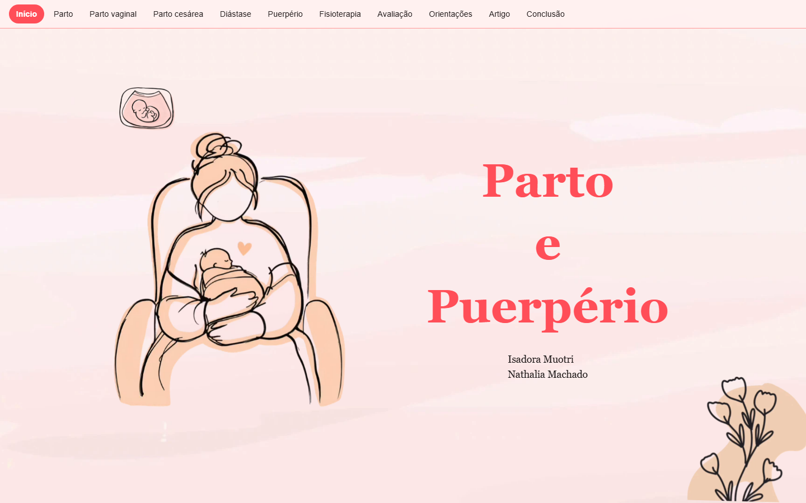

# Parto e Puerpério — Atuação da Fisioterapia

Site de página única que reorganiza uma apresentação acadêmica sobre **parto e puerpério** e o papel da fisioterapia em cada etapa: fases do parto vaginal e cesárea, disfunções mais comuns, diástase abdominal, avaliação, instrumentos, orientações e contraindicações.

**Demonstração:** https://handyedev.github.io/parto-puerperio-fisioterapia/



> Projeto de portfólio: conversão de uma apresentação de slides em um site responsivo, feito com HTML, CSS e JavaScript puros.

## Destaques

- **Landing page animada:** a ilustração, o ícone e a flor da capa flutuam suavemente e acompanham o mouse (paralaxe leve).
- **Pensado para apresentar:** as setas **←** e **→** pulam de seção em seção, como slides; o link da seção atual fica destacado na barra de navegação.
- **Artigo em dois idiomas:** a captura do artigo da *Frontiers in Medicine* tem um botão **EN / PT-BR** que alterna entre o original e a versão traduzida, em tamanho grande para leitura em tela cheia.
- **Acessibilidade:** link "Pular para o conteúdo", HTML semântico, foco visível, texto alternativo nas imagens informativas, `alt=""` nas decorativas e respeito a `prefers-reduced-motion`.
- **Desempenho:** imagens em WebP, `loading="lazy"` fora da capa e `width`/`height` em todas as imagens para evitar saltos de layout.
- **Compartilhamento:** favicon e metadados Open Graph (prévia ao colar o link em redes sociais).
- **Responsivo:** layout em grid que empilha no celular; tabelas largas rolam na horizontal.
- **Sem dependências:** nenhum framework nem build. A única chamada externa é a fonte *Lobster Two* (Google Fonts).

## Estrutura

```
.
├── index.html   # página inteira (estilos e scripts embutidos)
├── img/         # ilustrações, fotos e fundo (WebP) + og.jpg
├── docs/        # captura de tela usada neste README
└── README.md
```

## Como executar

Abra o `index.html` no navegador. Não precisa de servidor nem de instalação.

## Publicação

O site é publicado pelo GitHub Pages (branch `main`, pasta `/`). As tags Open Graph do `index.html` apontam para `https://handyedev.github.io/parto-puerperio-fisioterapia/`; se o repositório ou o usuário mudar de nome, atualize `og:url` e `og:image`.

## Tecnologias

HTML5 · CSS3 (grid, flexbox, variáveis, `@keyframes`) · JavaScript (IntersectionObserver, eventos de teclado)

## Créditos

### Conteúdo
Apresentação original de **Isadora Muotri** e **Nathalia Machado**. Conversão para site como exercício de portfólio.

### Imagens

| Imagens | Origem | Observação |
|---|---|---|
| `artigo.webp` | Página do artigo *The efficacy and safety of transcutaneous electrical nerve stimulation for labor analgesia in the first stage of labor*, Hu Z.-Y. et al., **Frontiers in Medicine**, vol. 13, 2026, DOI [10.3389/fmed.2026.1730360](https://doi.org/10.3389/fmed.2026.1730360) | © dos autores e da Frontiers. Confira a licença na página do artigo antes de reutilizar. |
| `artigo_pt.webp` | Obra derivada da captura acima | Texto da interface e do título **traduzido para português por este projeto**. Não é uma tradução oficial da Frontiers nem dos autores. |
| Ilustrações (mãe com bebê, flores, ícones, figuras de exercícios, marcadores) | Elementos gráficos do modelo "Pink Neutral Illustrated Maternal Health Presentation" (aparentemente do **Canva**) | Autoria individual não identificada. Sujeitas à licença do Canva e dos criadores dos elementos. |
| Fotos e esquemas das fases do parto, diástase e avaliação | Extraídos da apresentação original | Fonte e autoria originais **não identificadas**. |

As imagens foram extraídas de uma apresentação em vídeo e podem ter sido recortadas, redimensionadas e convertidas para WebP. Pertencem aos respectivos autores e são usadas **apenas para fins educacionais e de demonstração**, sem fins comerciais.

Se você é autor de alguma imagem e deseja crédito ou remoção, abra uma *issue* neste repositório.
